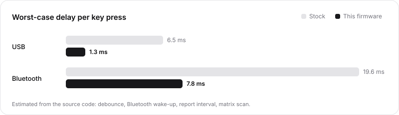

<p align="center">
  <a href="https://github.com/alban-minana/keychron-k4-pro-firmware/releases"></a>
  <a href="https://github.com/alban-minana/keychron-k4-pro-firmware/actions/workflows/build.yml"></a>
  <a href="license_GPLv2.md"></a>
</p>

Unofficial firmware for the **Keychron K4 Pro**: ISO and ANSI, RGB and white. It is built on Keychron's open-source code and QMK 0.34, stays compatible with VIA, and you can go back to stock at any time.

#### Why

- **Lower latency**: keys are sent on first contact, and Bluetooth runs at 133 Hz.
- **Bluetooth fixes**: no more stuck or repeating keys, and no lost key on wake-up.
- **Better battery**: the backlight turns off sooner and the battery percentage is accurate.

<picture>
  <source media="(prefers-color-scheme: dark)" srcset="k4pro/docs/latency-dark.svg">
  
</picture>

#### Install

1. Download the `.bin` for your keyboard from the [latest release](https://github.com/alban-minana/keychron-k4-pro-firmware/releases).
2. Install [QMK Toolbox](https://github.com/qmk/qmk_toolbox/releases).
3. Set the switch to **Cable**, then plug the keyboard in while holding <kbd>Esc</kbd>.
4. When QMK Toolbox shows *STM32 DFU device connected*, open the `.bin` and click **Flash**.

| Keyboard | File |
|---|---|
| ISO (tall Enter), RGB | `keychron_k4_pro_iso_rgb_<version>.bin` |
| ISO (tall Enter), white | `keychron_k4_pro_iso_white_<version>.bin` |
| ANSI (wide Enter), RGB | `keychron_k4_pro_ansi_rgb_<version>.bin` |
| ANSI (wide Enter), white | `keychron_k4_pro_ansi_white_<version>.bin` |

> [!NOTE]
> Holding <kbd>Esc</kbd> also resets the keyboard settings, so redo your VIA remapping afterwards.
> To go back to stock, flash [Keychron's firmware](https://github.com/Keychron/qmk_firmware/tree/bluetooth_playground/keyboards/keychron/k4_pro/firmware) the same way.

#### Changes

| Area | Stock | This firmware |
|---|---|---|
| Debounce | Every press waits 5 ms | Sent on first contact |
| Bluetooth rate | 90 Hz | 133 Hz |
| Bluetooth send | 3 ms pause before each report | Pause only after 1.5 s idle |
| Matrix scan | 2 shift-register writes per column | 1 write per column |
| Key pressed during reconnect | Lost | Sent once connected (≤ 3 s) |
| Backlight off on battery | 10 min, cuts out | 3 min, dims 10 s before |
| Battery % (<kbd>Fn</kbd>+<kbd>B</kbd>) | Linear estimate | Li-ion curve, faster animation |

**Fixed bugs**
- Stuck or repeating keys over Bluetooth after a full module buffer
- Media keys that kept repeating
- Bluetooth pairing code running inside an interrupt
- Possible memory corruption on a garbled Bluetooth packet
- NKRO setting ignored after PIN pairing
- Cable/Bluetooth switch not debounced (could flip modes while sliding)

Details: [k4pro/ANALYSIS.md](k4pro/ANALYSIS.md).

#### Settings

Options live at the top of [`keyboards/keychron/k4_pro/config.h`](keyboards/keychron/k4_pro/config.h).

| Option | Default | |
|---|---|---|
| `DEBOUNCE` | `5` | Raise to 7–8 if a switch double-types |
| `CKBT51_REPORT_RATE` | `133` | `90` = stock |
| `CKBT51_SMART_WAKE` | on | Disable if letters go missing over Bluetooth |
| `CONNECTED_BACKLIGHT_DISABLE_TIMEOUT` | `180` | Backlight off delay on battery (s) |
| `BACKLIGHT_DIM_PERCENT` | `30` | Brightness during the 10 s before it turns off |
| `BT_WAKE_KEY_BUFFER_MS` | `3000` | Keep keys typed during reconnect (`0` = off) |
| `BT_REPORT_BATTERY_LEVEL` | on | Send the battery level to the Bluetooth module (experimental: not shown by Windows) |

#### Build

```sh
k4pro/build.sh            # all variants, needs Docker
k4pro/build.sh iso/rgb    # one variant
```

GitHub Actions builds every push and pull request. Pushing a `v*` tag publishes a release.

#### Hardware

<picture>
  <source media="(prefers-color-scheme: dark)" srcset="k4pro/docs/hardware-dark.svg">
  
</picture>

#### Contributing

Open an [issue](https://github.com/alban-minana/keychron-k4-pro-firmware/issues/new/choose) with your variant and connection mode. Pull requests are welcome; CI must pass. See the [roadmap](https://github.com/alban-minana/keychron-k4-pro-firmware/issues).

<sub>Based on [Keychron/qmk_firmware](https://github.com/Keychron/qmk_firmware) and [QMK](https://github.com/qmk/qmk_firmware). GPL-2.0-or-later. Not affiliated with Keychron.</sub>
