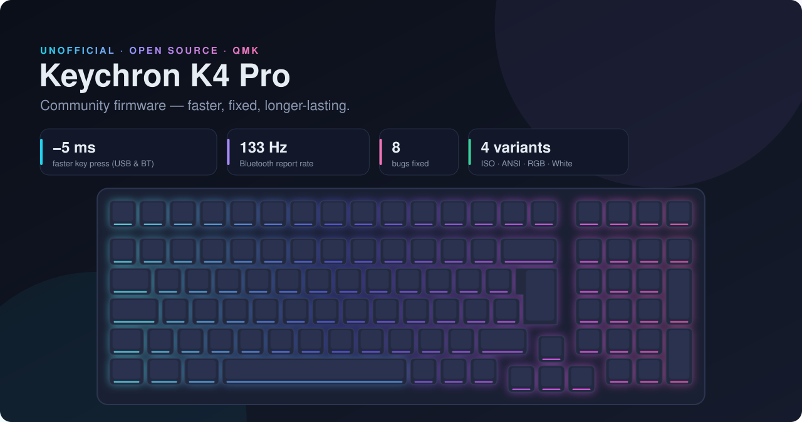
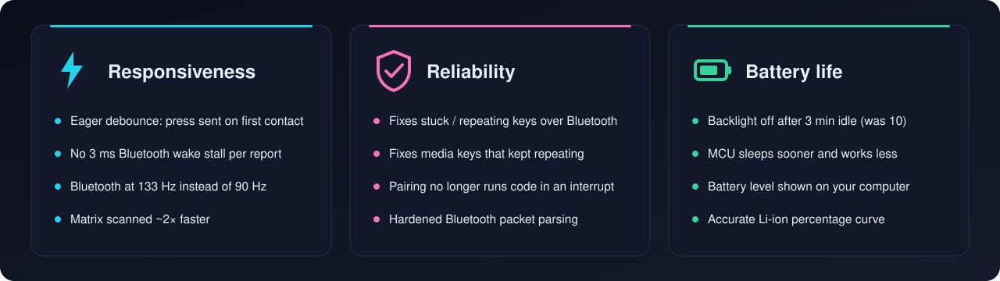
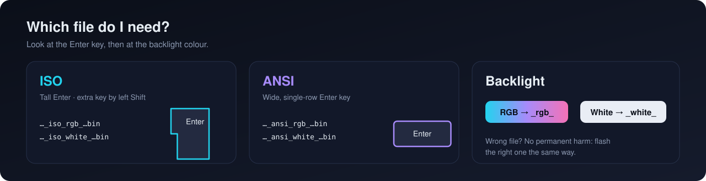
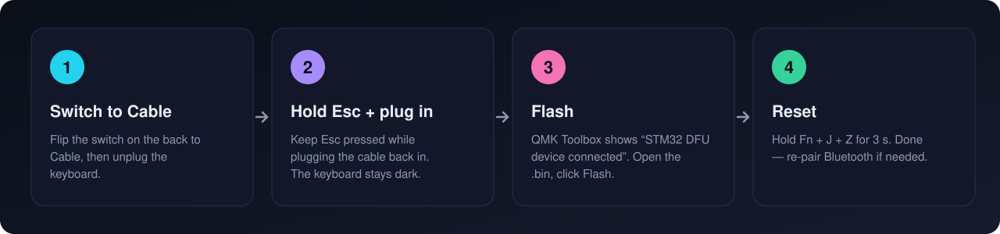
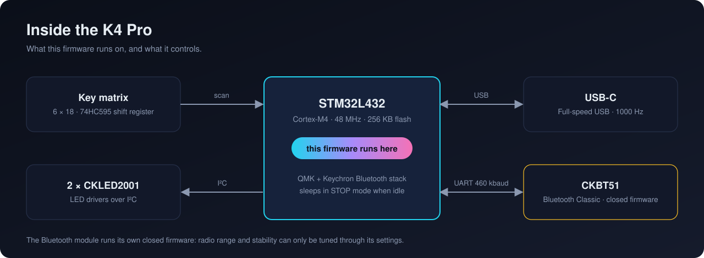

<p align="center">
  
</p>

<p align="center">
  <a href="https://github.com/alban-minana/keychron-k4-pro-firmware/releases"></a>
  <a href="https://github.com/alban-minana/keychron-k4-pro-firmware/actions/workflows/build.yml"></a>
  <a href="https://github.com/alban-minana/keychron-k4-pro-firmware/releases"></a>
  <a href="license_GPLv2.md"></a>
</p>

<p align="center">
  <b>An improved firmware for the Keychron K4 Pro</b>: ISO and ANSI, RGB and white backlight.<br>
  Same keyboard, same VIA support. <b>Lower latency, fewer Bluetooth bugs, longer battery life.</b>
</p>

<p align="center">
  <a href="#-download"><b>Download</b></a> ·
  <a href="#-flashing"><b>Flashing guide</b></a> ·
  <a href="#-whats-different"><b>What's different</b></a> ·
  <a href="#%EF%B8%8F-settings-you-can-tweak"><b>Settings</b></a> ·
  <a href="https://github.com/alban-minana/keychron-k4-pro-firmware/issues/new/choose"><b>Report a bug</b></a>
</p>

> [!IMPORTANT]
> This project is **not affiliated with Keychron**. Flashing custom firmware is at your own risk, but nothing is permanent: the keyboard has a built-in bootloader and you can [go back to stock](#%EF%B8%8F-going-back-to-stock) at any time.

---

## ✨ What's different



### Latency


| | Stock Keychron | This firmware |
|---|---|---|
| Debounce | `sym_defer_g`: every press waits 5 ms | `sym_eager_pk`: sent on first contact, bounces filtered afterwards |
| Bluetooth wake pulse | Blocking 3 ms before **every** report | Only when the module may be asleep (> 1.5 s idle) |
| Bluetooth report rate | 90 Hz (11.1 ms) | 133 Hz (7.5 ms) |
| Matrix scan | 2 shift-register writes + 2 delays per column | 1 write + 1 delay per column (~2× faster) |
| Key pressed while Bluetooth reconnects | Dropped | Sent once connected, if within 3 s |

### Bug fixes

| Bug | Symptom |
|---|---|
| A rejected Bluetooth report was replaced by an older one | **Stuck or repeating key** over Bluetooth until the next key press |
| Same for media reports | Volume keeps going up or down |
| Pairing (<kbd>Fn</kbd>+<kbd>1</kbd>/<kbd>2</kbd>/<kbd>3</kbd> long press) ran UART code inside an interrupt | Rare glitches or freezes while pairing |
| Unbounded packet length from the Bluetooth module | Memory corruption on a garbled packet |
| Out-of-bounds read on the first host indicator update | Stray LED flash |
| NKRO forced on after PIN-code pairing | Your NKRO setting ignored over Bluetooth |
| Two minor issues (latent protocol bug, off-by-one) | none visible |

### Battery

- Backlight turns off after **3 min** idle on Bluetooth (stock: 10 min). The microcontroller can only sleep once the backlight is off, so this has the biggest effect.
- **Battery level shown by your OS**: the percentage is sent over Bluetooth, so Windows, macOS and iOS can display it.
- **Accurate percentage** (<kbd>Fn</kbd>+<kbd>B</kbd>): real Li-ion discharge curve instead of a linear 3.5–4.1 V mapping.
- Less CPU time per key press (no 3 ms busy-wait, faster scan).

The full technical write-up is in [k4pro/ANALYSIS.md](k4pro/ANALYSIS.md).

---

## 📦 Download



Get the file for your keyboard from the **[latest release](https://github.com/alban-minana/keychron-k4-pro-firmware/releases)**:

| Your keyboard | File |
|---|---|
| ISO, RGB backlight | `keychron_k4_pro_iso_rgb_<version>.bin` |
| ISO, white backlight | `keychron_k4_pro_iso_white_<version>.bin` |
| ANSI, RGB backlight | `keychron_k4_pro_ansi_rgb_<version>.bin` |
| ANSI, white backlight | `keychron_k4_pro_ansi_white_<version>.bin` |

Releases tagged `-beta` have not yet been validated on every variant. Checksums are in `SHA256SUMS.txt`.

---

## ⚡ Flashing



1. Install [QMK Toolbox](https://github.com/qmk/qmk_toolbox/releases). On Windows, accept the driver installation on first launch (or *Tools → Install Drivers*).
2. Set the switch on the back to **Cable** and unplug the keyboard.
3. Hold <kbd>Esc</kbd> while plugging the cable back in. The keyboard stays dark.
   *Alternative: remove the space bar keycap and hold the small **reset** button underneath while plugging in.*
4. QMK Toolbox shows a yellow line, *STM32 DFU device connected*. Open the `.bin` and click **Flash**. Leave the *MCU* field as is, because it only matters for AVR keyboards. Do not unplug until you see *Flash complete*.
5. Hold <kbd>Fn</kbd>+<kbd>J</kbd>+<kbd>Z</kbd> for 3 seconds to factory reset (the backlight blinks red).
6. On Bluetooth, re-pair if needed: hold <kbd>Fn</kbd>+<kbd>1</kbd> for 3 seconds.

VIA and Keychron Launcher keep working. Your remapping may need to be redone after the factory reset.

## ↩️ Going back to stock

Flash Keychron's official firmware the same way. It is available from Keychron's website, or as `.bin` files in [Keychron's repository](https://github.com/Keychron/qmk_firmware/tree/bluetooth_playground/keyboards/keychron/k4_pro/firmware).

---

## ⚙️ Settings you can tweak

All options are grouped at the top of [`keyboards/keychron/k4_pro/config.h`](keyboards/keychron/k4_pro/config.h):

| Option | Default | Effect |
|---|---|---|
| `DEBOUNCE` | `5` | Raise to 7–8 if a worn switch double-types |
| `CKBT51_SMART_WAKE` | on | Comment out if characters go missing over Bluetooth |
| `CKBT51_REPORT_RATE` | `133` | `90` = stock, slightly less radio power |
| `CONNECTED_BACKLIGHT_DISABLE_TIMEOUT` | `180` | Backlight off delay on battery, in seconds |
| `BT_WAKE_KEY_BUFFER_MS` | `3000` | Keys typed while reconnecting are sent if the link is back within this delay (`0` = off) |
| `BT_REPORT_BATTERY_LEVEL` | on | Send the battery level to the host OS over Bluetooth |

## 🛠️ Building it yourself

```sh
git clone https://github.com/alban-minana/keychron-k4-pro-firmware.git
cd keychron-k4-pro-firmware
k4pro/build.sh            # all 4 variants (needs Docker)
k4pro/build.sh iso/rgb    # a single variant
```

Binaries land in `k4pro/out/`. GitHub Actions builds every push and pull request, and pushing a `v*` tag publishes a release automatically.

## 🔬 Under the hood



## 🗺️ Roadmap

Planned work is tracked in the [issues](https://github.com/alban-minana/keychron-k4-pro-firmware/issues): measured latency numbers, Bluetooth NKRO tuning, smarter backlight on battery, extra QMK features (Caps Word, Fn-lock…), and a port to a current QMK base.

## 🤝 Contributing

Bug reports and ideas are welcome. Please [open an issue](https://github.com/alban-minana/keychron-k4-pro-firmware/issues/new/choose) and give your variant and connection mode.
Pull requests are reviewed before merging, and all 4 variants must build in CI. See [CONTRIBUTING](.github/CONTRIBUTING.md).

## 📄 Credits & license

- Based on [Keychron/qmk_firmware](https://github.com/Keychron/qmk_firmware) (branch `bluetooth_playground`), itself based on [QMK](https://github.com/qmk/qmk_firmware).
- Licensed under the GPL, like QMK and Keychron's code (see `license_GPLv2.md` and `license_GPLv3.md`).
- Keychron is a trademark of its owner. This project is unofficial and not endorsed by Keychron.
