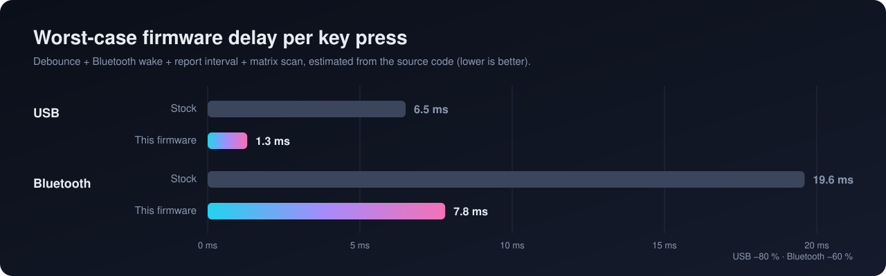

# Keychron K4 Pro — Community Firmware (unofficial)

[](https://github.com/alban-minana/keychron-k4-pro-firmware/actions/workflows/build.yml)
[](https://github.com/alban-minana/keychron-k4-pro-firmware/releases)
[](license_GPLv2.md)

An improved firmware for the **Keychron K4 Pro** (ISO / ANSI, RGB / White), built on
Keychron's own open-source QMK code. Same keyboard, same VIA support — **lower latency,
fewer Bluetooth bugs, better battery life.**

> [!IMPORTANT]
> This project is **not affiliated with Keychron**. Flashing custom firmware is at your own risk.
> You can always go back to the stock firmware (see [Going back to stock](#going-back-to-stock)).



## What's different from the stock firmware

### Responsiveness
| | Stock | This firmware |
|---|---|---|
| Debounce | `sym_defer_g`: every press waits 5 ms | `sym_eager_pk`: sent on first contact, bounces filtered afterwards |
| Bluetooth wake pulse | Blocking 3 ms before **every** report | Only when the module UART may be asleep (>1.5 s idle) |
| Bluetooth report rate | 90 Hz (11.1 ms) | 133 Hz (7.5 ms) |
| Matrix scan | 2 shift-register writes + 2 delays per column | 1 write + 1 delay per column (~2× faster scan) |
| Key pressed while Bluetooth reconnects | Dropped (the wake-up key is lost) | Kept and sent once connected, if within 3 s |

### Bug fixes
- **Stuck / repeating key over Bluetooth (6KRO)**: when the BT module reported a full FIFO, the firmware re-sent an *older* report and dropped the rejected one (often a key release).
- Same issue for media keys (volume kept changing).
- Bluetooth pairing (long press <kbd>Fn</kbd>+<kbd>1</kbd>/<kbd>2</kbd>/<kbd>3</kbd>) ran UART code and a 3 ms busy-wait inside an interrupt.
- Unbounded packet length from the BT module could overflow a 32-byte stack buffer.
- Out-of-bounds read on the first Bluetooth host indicator update.
- NKRO forced on after PIN-code pairing, ignoring the user setting.
- Minor: latent protocol bug, off-by-one in the battery animation.

### Battery
- Backlight turns off after **3 min** idle on Bluetooth (stock: 10 min). The MCU can only sleep once the backlight is off, so this is the biggest lever.
- Less CPU time per key press (no 3 ms busy-wait, faster scan).
- **Accurate battery level** (<kbd>Fn</kbd>+<kbd>B</kbd>): real Li-ion discharge curve instead of a linear 3.5–4.1 V mapping.
- **Battery level shown by your OS**: over Bluetooth the percentage is sent to the host (Windows / macOS / iOS Bluetooth settings). Stock firmware never sent it.

Full technical write-up: [k4pro/ANALYSIS.md](k4pro/ANALYSIS.md).

## Download

Get the `.bin` for your variant from the [latest release](https://github.com/alban-minana/keychron-k4-pro-firmware/releases):

| Your keyboard | File |
|---|---|
| ISO, RGB backlight | `keychron_k4_pro_iso_rgb_<version>.bin` |
| ISO, white backlight | `keychron_k4_pro_iso_white_<version>.bin` |
| ANSI, RGB backlight | `keychron_k4_pro_ansi_rgb_<version>.bin` |
| ANSI, white backlight | `keychron_k4_pro_ansi_white_<version>.bin` |

ISO = tall Enter key and an extra key next to left Shift. ANSI = wide Enter key.
Releases tagged `-beta` have not been validated on every variant yet.

## Flashing

1. Install [QMK Toolbox](https://github.com/qmk/qmk_toolbox/releases).
2. Set the keyboard switch to **Cable** and unplug it.
3. Hold <kbd>Esc</kbd> while plugging the cable back in. (Alternative: remove the space bar keycap and hold the small **reset** button under it while plugging in.)
4. QMK Toolbox shows *STM32 DFU device connected*. Open the `.bin`, click **Flash**.
5. Factory reset: hold <kbd>Fn</kbd>+<kbd>J</kbd>+<kbd>Z</kbd> for 3 seconds.

Your VIA / Keychron Launcher remapping keeps working; you may need to redo it after the factory reset.

## Going back to stock

Flash Keychron's official firmware the same way. It is available from Keychron's website, or as `.bin` files in [Keychron's repository](https://github.com/Keychron/qmk_firmware/tree/bluetooth_playground/keyboards/keychron/k4_pro/firmware).

## Settings you can tweak

All options live at the top of [`keyboards/keychron/k4_pro/config.h`](keyboards/keychron/k4_pro/config.h):

| Option | Default | Effect |
|---|---|---|
| `DEBOUNCE` | `5` | Raise to 7–8 if a worn switch double-types |
| `CKBT51_SMART_WAKE` | on | Comment out if characters go missing over Bluetooth |
| `CKBT51_REPORT_RATE` | `133` | `90` = stock, slightly less radio power |
| `CONNECTED_BACKLIGHT_DISABLE_TIMEOUT` | `180` | Backlight off delay on battery (seconds) |
| `BT_WAKE_KEY_BUFFER_MS` | `3000` | Keys typed while reconnecting are sent if the link is back within this delay (`0` = off) |
| `BT_REPORT_BATTERY_LEVEL` | on | Send the battery level to the host OS over Bluetooth |

## Building it yourself

```sh
git clone https://github.com/alban-minana/keychron-k4-pro-firmware.git
cd keychron-k4-pro-firmware
k4pro/build.sh            # all 4 variants, needs Docker
k4pro/build.sh iso/rgb    # a single variant
```

Binaries land in `k4pro/out/`. Every push is also built by GitHub Actions, and pushing a `v*` tag publishes a release automatically.

## Hardware


## Contributing

Bug reports and ideas are welcome. Please open an [issue](https://github.com/alban-minana/keychron-k4-pro-firmware/issues/new/choose) and give your variant and connection mode.
Pull requests are reviewed before merging, and CI must pass. See [CONTRIBUTING](.github/CONTRIBUTING.md).

## Credits & license

- Based on [Keychron/qmk_firmware](https://github.com/Keychron/qmk_firmware) (branch `wls_2025q1`), itself based on [QMK](https://github.com/qmk/qmk_firmware).
- Licensed under the GPL, like QMK and Keychron's code (see `license_GPLv2.md`, `license_GPLv3.md`).
- Keychron is a trademark of its owner. This project is unofficial.
